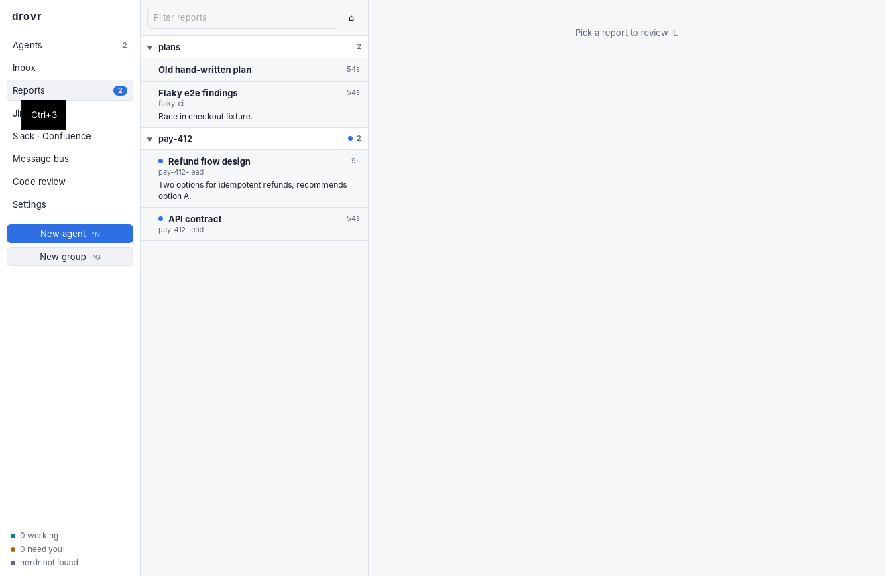

<br>

# drovr

A lightweight macOS desktop cockpit (Tauri + Svelte) for running Claude Code agents. Pull up a Jira ticket, hand it to one agent or to a group led by an orchestrator, and review what they do.

- **One inbox:** agents bring you their decisions, proposed commands and permission requests there.
- **Agents coordinate:** they message each other directly when their work overlaps.
- **Reports:** agents save HTML reports for you to review in `~/.claude/plans/`.
- **Where agents run:** drovr runs them itself, or in [herdr](https://herdr.dev) panes next to your terminal.
- **Which CLI runs them:** Claude Code, or OpenAI's Codex CLI (experimental). See [Harnesses](#harnesses-claude-code-and-codex).
- **A ticket workflow (optional, off by default):** a record and timeline of each ticket's work, a watcher that follows your sprint and its PRs, stages with handoffs you approve, Jira and Confluence updates you review before they're posted, and a retro you start. One switch, `workflow.enabled`; see [The record](#the-record-timeline).

**[USAGE.md](USAGE.md)** covers the commands and everyday workflows: keyboard shortcuts, recipes for each task, and the full CLI reference.



## Contents

- [Status](#status)
- [Quick start](#quick-start)
- [Using drovr](#using-drovr)
- [How it works](#how-it-works)
- [Configuration](#configuration)
- [Files and data](#files-and-data)
- [CLI](#cli) (full reference in [USAGE.md](USAGE.md#cli-reference))
- [Building, signing and CI](#building-signing-and-ci)
- [Development](#development)
- [Troubleshooting](#troubleshooting)
- [License](#license)

## Status

drovr is at version 0.5.0. <!-- x-release-please-version -->

**Tested so far:**

- **On a Mac:**
  - The app runs day to day with real agents and groups.
  - Jira, Confluence and Slack lookups work through real MCP servers.
- **Signing:** a signed and notarized build works, both built locally (`pnpm tauri:build:signed`) and from the release workflow on a `v*` tag.
- **CI:** PR CI runs the tests, the type-check and clippy (any warning fails it).
- **On Linux:**
  - **The app:** each view and the Inbox actions were clicked through on a virtual display.
  - **The real Claude Code CLI:** the coordination tools, the permission prompt, and `publish_report`.
  - **A logging stand-in for herdr:** it confirms the exact `herdr` commands, and the parsing was checked against real `herdr agent get` output.
  - **The app in WebKit** (WebKitGTK with `tauri-driver` on a virtual display): the content security policy, the asset protocol's scope, the Inbox keys, the shortcut list and the long-diff view.
  - **The Codex CLI** (0.164.0, not logged in): drovr's `-c` overrides, its MCP server starting under Codex, and resuming a Codex session.
  - **The ticket workflow in WebKit**, with stand-ins for `claude`, `twg` and `gh`: the record and timeline, the watcher and Pipeline, rules and Jira drafts, stages and handoffs, the retro, and Confluence pages (the diff, the sandboxed preview, a page that changed before you approved it).
- **twg's real output:** `jira workitem query` and `get` (with and without `-o json`) and `confluence content get --detail full`.
- **twg's write commands against a real site:** posting a Jira comment and moving a ticket.

**Not yet checked:**

- Live herdr panes.
- Codex agents with a logged-in Codex, doing real work.
- Saving a Confluence draft with twg against a real site.

## Quick start

**You need:**

- Xcode Command Line Tools: `xcode-select --install`
- Rust: `curl --proto '=https' --tlsv1.2 -sSf https://sh.rustup.rs | sh`
- Node 24+ and pnpm: `brew install node pnpm`
- Claude Code (`claude`), logged in, with your Jira, Confluence and Slack MCP servers set up
- herdr (optional): `brew install herdr`
- For the ticket workflow (optional): Atlassian's [twg](https://atlassian.github.io/twg-cli/) for Jira and Confluence, and the GitHub CLI (`gh`), both logged in

**Run it:**

```sh
git clone https://github.com/izz-linux/agentic-workflow drovr && cd drovr
mkdir -p ~/.config/drovr && cp config.example.toml ~/.config/drovr/config.toml
# edit ~/.config/drovr/config.toml: at least defaults.cwd (where new agents start)
cd app
pnpm install
pnpm tauri dev
```

The first build compiles the Rust side and takes a few minutes. After that, `pnpm tauri dev` starts in seconds.

**Optional:** put the CLI on your PATH, for scripting and for herdr panes:

```sh
cargo install --path crates/drovr-cli
```

## Using drovr

### Views

| View | ⌘/Ctrl | What it's for |
| --- | --- | --- |
| Agents | 1 | Each agent's live state and streamed output, with a prompt box and controls |
| Inbox | 2 | Everything waiting on you |
| Reports | 3 | HTML reports in `~/.claude/plans/` |
| Jira | 4 | Find a ticket, read it, hand it off |
| Slack · Confluence | 5 | Search, read, send results to an agent, or ask a free-form question |
| Message bus | 6 | Agents' messages to each other, and each group's shared notes, with a filter |
| Code review | 7 | Changed files and diffs in each repo and worktree an agent worked in |
| Settings | 8 | Theme, and your config file |
| Pipeline | 9 | Your sprint, its PRs and the agents on each ticket, and the retros (only with `workflow.enabled`) |

A ticket's **Timeline** opens over any view, from an agent's header, a group, or Pipeline.

**Shortcuts** (⌘/Ctrl+/ lists them all in the app; [USAGE.md](USAGE.md#keyboard-shortcuts) has the table):

- **Anywhere:** ⌘/Ctrl+1 … 9 switch views. ⌘/Ctrl+N starts a new agent and ⌘/Ctrl+G a new group. ⌘/Ctrl+F (Edit → Find…) finds text in the selected agent's output, or focuses the filter on the Message bus. ⌃` shows or hides the terminal. Esc closes a dialog.
- **In an agent's prompt box:** Enter sends and Shift+Enter adds a new line.
- **In the Inbox:** ↓↑ or J K move, 1–9 pick an option, A allows or starts, D denies or declines (see [Inbox](#inbox)).
- **In Settings:** ⌘/Ctrl+S saves.

### Agents

Each agent has a state:

| State | Meaning |
| --- | --- |
| working | It's running. |
| blocked | Something of its is waiting in your Inbox. |
| idle | It ended its turn. It wakes up when a message or answer arrives for it. |
| done | It called `report_done`. |
| error | Its last run failed. |
| stopped | You stopped it. |
| interrupted | Its run was killed before finishing (a reboot or crash). **Resume** or **Resume all** continues the same conversation. |

In the agent list, click a group's name to collapse or expand it; a collapsed group still shows how many of its agents are working or blocked. ⊟ collapses every group at once. Your choices are remembered, and filtering shows matching agents even inside collapsed groups.

The Agents view shows each agent's output as it runs: text, tool calls with their results, and the cost of each run. Costs are Claude Code's estimate at API list prices (`total_cost_usd`): what your plan actually charges may differ. Claude Code reports a running total for the whole conversation, so drovr counts only what each run added. The total next to an agent covers its headless runs; herdr agents' costs aren't tracked, and Codex reports tokens rather than a cost. An agent that has cost more than `defaults.cost_warning_usd` ($10 by default) is flagged in yellow in the list and its header.

- **Prompt:** type in the box and send. If the agent is busy, your text is queued: it shows above the box, marked **Queued**, until the agent reads it, either when it checks its messages or when its run ends. Each queued message has two buttons:
  - **Send now** stops the current run and starts a new one with that message, plus anything else waiting for the agent before it. The agent is told its last run was cut short.
  - **✕** takes the message back and puts its text in the box to edit.
- **Copy on select:** selecting text in the output copies it. Turn it off with `defaults.copy_on_select = false`.
- **Stop, Resume, Remove:** Stop ends the current run (it shows while the agent is working). Resume continues the same conversation. **✕** removes the agent and its output in drovr once you click it and then **Remove?**, and dismisses anything of its still in the Inbox; its Claude Code session is kept. If drovr made it a worktree, the worktree is removed too when nothing in it is uncommitted, and kept (with a note saying so) when something is. Its `drovr/<name>` branch always stays, and an agent started later under the same name picks up that branch, or the worktree if it's still there.
- **Open in herdr:** opens the agent's session interactively in a new herdr pane. Without herdr, **Copy attach cmd** copies a `cd … && claude --resume …` command for any terminal.
- **Terminal:** a terminal under the output. See below.

### Terminal

**Terminal** in an agent's header, **View → Toggle Terminal** or ⌃` shows and hides a terminal under the agent's output. Drag its top edge to resize it.

- **Which terminal you get:**
  - A group shares one terminal. It opens in your home folder, like a new iTerm2 window, and stays the same as you click between the lead and its workers.
  - A solo agent has its own terminal. It opens in the repo or worktree the agent worked in most recently, the same one Code review lists first, or else in its working directory.
- **Your shell setup:** it runs your shell (`$SHELL`, or `terminal.shell`) as a login shell, so `.zprofile` and `.zshrc` load and your aliases, functions, prompt and PATH are all there. `TERM` is `xterm-256color` with true color.
- **What it is:** a real terminal (xterm.js on a pseudo-terminal), so `vim`, `htop`, `git add -p` and `claude` work.
- **Keys:** Ctrl keys go to the shell (^C, ^R, ^N…). ⌘ shortcuts still work: ⌘C and ⌘V copy and paste, and ⌘1–⌘9 switch views.
- **Copy on select:** selecting text (a drag, or a double- or triple-click) copies it, like iTerm2. Turn it off with `terminal.copy_on_select = false`.
- **Lifetime:** hiding the panel or switching agents keeps the shell running with its scrollback. Quitting drovr ends the shells. If a shell exits, press Enter in the panel to start a new one.
- **When a command won't stop:** **Stop job** in the panel's bar force-stops whatever is running (the whole pipeline) when ^C doesn't, and keeps the shell. **Restart shell** ends the shell and everything in it and starts a new one, keeping the scrollback above a marker.
- **Inbox commands:** **Run in terminal** on an Inbox command types it into the agent's terminal, after a `cd` into the folder the agent proposed it for. If the terminal is just starting, drovr waits for your shell's prompt first (with zsh and fish, until its line editor is ready), so your startup files never see the command. If no prompt appears within 20 seconds, it tells you instead of typing. You check the command and press Enter. **Mark as run** then sends the agent what the command printed, unless you typed a note.

### Starting agents

**New agent** (⌘/Ctrl+N) opens with your configured defaults filled in: the working directory, the backend (headless or herdr), and a line showing the model, permission mode and worktree setting from your config.

- **Name:** lowercase letters, digits, `-` and `_`, starting with a letter. What you type is lowercased and spaces become dashes as you type, so macOS capitalizing the first letter doesn't matter. Other characters are flagged rather than guessed at. The CLI does the same.
- **Task:** the agent's first prompt. Type it, or pick a `.md` or `.txt` file under **Prompt from file** to load it into the box, where you can still edit it.
- **Jira ticket:** the ticket the agent's work tracks. Or check **Create a Jira ticket for this**, with optional notes ("a bug, assigned to me, in the current sprint"): the agent first writes a ticket for its task, following `jira.ticket_skill` if set, and creates it. Its create command comes to the Inbox for you to allow like any other. It then calls `set_ticket`, and the new key becomes its ticket (and its group's, when it leads a group without one).
- **Group:** putting the agent in a group means it coordinates with the group's other agents. Its prompt files and reports then come from the group's plans folder.
- **Run with:** Claude Code, or Codex (experimental, when `codex` is installed). See [Harnesses](#harnesses-claude-code-and-codex).
- **Closing the dialog:** once you've typed a task, Esc or a click outside asks first: do it again within a few seconds to discard the typing. **Cancel** and **✕** close it straight away.

### Starting from an existing Claude Code session

In **New agent**, choose **Existing Claude session**:

1. Pick a recent session from the list, or paste a session ID, the one you'd give `claude --resume <id>`.
2. The working directory is filled in from the session, because `claude --resume` only finds a session from the folder it ran in.
3. Task is optional. Leave it empty and the agent is told it's now running in drovr and continues where it left off.

The agent continues that conversation with drovr's tools added. Turn on **Fork** if the session is still open in a terminal or a herdr pane: the agent then works in a copy (`claude --resume <id> --fork-session`), and the original is left alone. From the CLI, use `drovr sessions` to list sessions and `drovr adopt <session-id> <name> [--fork] [task…]` to start one.

### Groups

A group is a set of agents that coordinate with each other and share a plans folder in `~/.claude/plans/`.

**From plans you already have:**

1. **New group** (⌘/Ctrl+G) lists the subfolders of `~/.claude/plans/`, with how many prompt files each holds.
2. Pick the folder. Its name can have capitals or spaces; the group gets a drovr name from it, e.g. `Pay API` becomes `pay-api`.
3. Leave **Start an orchestrator** off and choose **Create, then add agents**.
4. New agent opens with the group preselected. Pick a prompt file from the folder and start the agent. Its name starts with the group's, e.g. `pay-api-coordinator`.
5. Add the rest of the group's agents with the group's **+ agent** button in the Agents view.

Every agent in the group knows its peers and its plans folder. They message each other directly and publish reports into that same folder. Without an orchestrator, they bring decisions to you through the Inbox.

### Groups with an orchestrator

Check **Start an orchestrator** when you create a group, hand off a Jira ticket as a group, or click a group's **+ lead** button. The group then gets a `<group>-lead` agent that works toward the goal. The lead:

1. Plans the work, then calls `spawn_worker` for each task. Workers are named `<group>-<task>`. There are at most `orchestrator.max_workers` of them, and they start without asking unless you set `orchestrator.auto_spawn = false`.
2. Coordinates them. Workers message each other and the lead, and claim files on the group's shared notes board, e.g. `owner:src/api.ts = sre-123-api`.
3. Brings you decisions as options, commands to approve, and reports.
4. Reviews the combined result when every worker has reported done.

When a worker reports done, the lead is woken automatically.

### Inbox

| Item | Your options |
| --- | --- |
| **Decision** | Click an option, or write your own answer |
| **Command** | Edit it, then **Run & return output** (it runs in the agent's directory and the output goes back to the agent), **Run in terminal** (typed into the agent's terminal for you to check and run), **Run in herdr pane**, or **Copy** it. After running it yourself, **Mark as run** tells the agent, with your note or else the terminal's output. Or **Reject** with a reason. |
| **Permission** | A headless agent wants a tool that isn't auto-allowed: **Allow**, or **Deny** with a reason |
| **Spawn** | Approve or decline a new worker (only when `auto_spawn = false`). Approving checks `orchestrator.max_workers` again, in case others started meanwhile. |
| **Finished** | An agent's `report_done` summary, with a link to its code review |
| **Watcher** | With `workflow.enabled`: something changed on a ticket or its PR, and `watch.rules` says to ask you. **Send to &lt;agent&gt;** passes it on with the details, or dismiss it |
| **Jira draft** | With `workflow.enabled`: a comment or move drovr drafted (when a PR merges) or an agent drafted (`draft_jira_update`). Edit it, then **Post to Jira**, or **Discard**. Nothing is posted until you do |
| **Handoff** | In a group that works in stages: a stage finished. Read the handoff, then **Approve** (with the next stage's model in the box) or **Send back** with notes |
| **Confluence** | An agent wrote a page (`publish_confluence`): the diff against the live draft and the full page. **Save as draft in Confluence** or **Send back** with notes. It never publishes; see [Pages agents write](#pages-agents-write) |

Answering wakes the agent if it's idle.

- **Keyboard:** ↓↑ (or J K) move between items, 1–9 pick a decision's option (or a Watcher item's **Send to**), A allows a permission or starts a worker, and D denies or declines one, with the reason typed in its box. Keys don't fire while you're typing in a box.
- **Notifications:** when something new lands in the Inbox while you're in another app, drovr sends a macOS notification (turn it off with `notifications.enabled = false`). The Dock icon's badge shows how many items are waiting.

### Reports

Reports are everything you need to look at and review, saved as HTML in `~/.claude/plans/` (change with `reports.dir`). Links in reports, agent output and the Inbox open in your default browser, never inside drovr.

- **Where agents save:** agents publish with the `publish_report` tool. A group's reports go in `~/.claude/plans/<group>/`, so all the plans and designs for one piece of work stay together. A solo agent's go in the root folder.
- **Revisions replace:** when an agent publishes a title it already published in that folder, the new version replaces its file and shows as unread again. Older copies with the same title, from before drovr did this, are folded under the newest one as **earlier versions**.
- **Order:** newest first, in each folder and across folders.
- **What the view lists:** every `.html` file in the folder and its subfolders, including ones you or other tools put there. They're grouped by folder, newest first.
- **Unread:** a report an agent published shows a dot until you open it, and the sidebar shows an unread count. **Mark all read** clears them.
- **On each report:** preview it, **Open in browser**, **Show folder** (in Finder), or send feedback to any agent.
- **Previews run as the page would in a browser:** its scripts, theme and saved settings (`localStorage`) work, and its own images and stylesheets load from next to it. It can load files only from the plans folder and the repos you've opened in Code review. The same goes for HTML previews in Code review. See [Security](#security).

Markdown files in the folder are ignored.

### The record (timeline)

drovr keeps a record of everything that happens on a ticket, so you can look back at how the work went and, later, run a retro on it.

**It's off by default, as one switch:** `workflow.enabled = true` (in `[workflow]`) turns on the whole ticket workflow together: the record and timeline, agents' `record_decision` and `draft_jira_update` tools, the watcher and Pipeline (⌘9), stages in groups created from then on, and the retro. Set it back to `false` and drovr works exactly as before: nothing more is recorded or polled, agents get the old tools from their next run, and the timeline buttons and Pipeline go away. Records already written stay on disk. The switch takes effect when you save it in Settings; agents pick it up on their next run.

The record is plain files: `ledger.jsonl` in the ticket's own folder, one JSON event per line, only ever appended to. The folder is in the group's plans folder (`~/.claude/plans/<group>/<TICKET>/`), or in the plans folder itself for a solo agent's ticket (`~/.claude/plans/<TICKET>/`). You can read the file in any editor, keep it in git, or hand it to an agent.

- **Which agents:** an agent's events go to its own tickets (its **Ticket** field, e.g. `SRE-3230, SRE-3253`), or to its group's ticket when it has none. An agent with no ticket has no record.
- **What's recorded:**
  - **Agents:** agents starting and being removed.
  - **Runs:** each run's start (its prompt, the configured model, a new or resumed session) and its end (how it ended, cost, duration, turns, tokens in and out and from the cache, and the models it used).
  - **The Inbox:** each item as it's asked (questions, commands, permissions, worker requests, done reports) and how it was resolved (answered, declined or dismissed, and how long it waited).
  - **Agent decisions:** what agents decided themselves, with `record_decision`.
  - **Messages:** messages between agents and from you.
  - **Your actions:** your prompts, stops, resumes, **Send now** and messages you took back.
  - **What agents report:** status lines, notes and published reports.
  - **Wakes:** wakes and paused wakes.
  - **Jira and PRs:** what the watcher sees (status, assignee and comment changes, PRs linked, CI, reviews, conflicts, merges), moves on dispatch, and a ticket an agent took with `set_ticket`.
  - **Stages:** handoffs, approvals and send-backs, checkpoints and fresh sessions.
  - **Retros:** retros started, proposals, and what you decided.
- **Secrets stay out:** anything that looks like a credential (GitHub, GitLab and Slack tokens, Anthropic and AWS keys, bearer tokens) is replaced with `[redacted]` before it's written.
- **Timeline:** **Timeline** in an agent's header, or **timeline** on a group, shows the record. It has a day-by-day list you can filter (runs, decisions and the Inbox, messages and prompts, status and reports, agents and wakes, Jira and PRs, stages, retro) with totals at the top: runs and cost, questions asked and declined, decisions, wakes. Click an event to see all of it. **Show folder** opens the ticket's folder in Finder, and **Start retro** starts a retro on the ticket.
- **Nothing else changes:** writing the record never stops the work. If a write fails, drovr logs it and carries on.

### Stages

Part of the ticket workflow (`workflow.enabled`). A ticket goes through stages, each its own agent: by default **triage → research → blueprint → build → close** (`stages.order`). You approve every handoff between them.

- **Only groups made with the workflow on:** a group created while `workflow.enabled` is on is marked for stages ("in stages" under its ticket in the agent list), and only its lead and agents get the stage process and the `handoff` and `checkpoint` tools. Groups from before, or made with it off, keep working as they did, so turning the workflow on doesn't change a long-running group mid-task; they still get the record, the timeline and the watcher. Turning it off stops stages in every group.
- **A group and a lead per ticket:** with the workflow on, **Dispatch…** defaults to **New group + orchestrator**. The lead spawns each stage's agent (`spawn_worker` with a `stage`), named after the stage, and the build stage can be several agents in parallel. Each stage agent runs on its stage's model, `stages.models.<stage>`, or the default when that isn't set.
- **What each stage does:**
  - triage: scopes the ticket.
  - research: finds what the design needs.
  - blueprint: designs it, asking you the decisions that are yours.
  - build: implements it and keeps its PR green; the watcher wakes it with CI failures and reviews.
  - close: wraps up and drafts the Jira update.
- **Handoffs:** a stage ends with `handoff`. drovr writes it to `handoffs/NN-<stage>.md` in the ticket's folder (summary, outputs, decisions, open questions, and what the next stage starts from) and puts it in the Inbox. Your options:
  - **Approve:** the stage's agent stops, and the lead is told to start the next stage from that file. Change the model in the box first to run the next stage on another one.
  - **Send back** with notes: the agent gets them and hands off again. This counts as rework in the record.
  - **The last stage:** approving it removes the stopped stage agents (`stages.tidy_on_close`). Their sessions and the record stay.
- **Build checkpoints:** once the build stage's context passes `stages.build_checkpoint_tokens` (150,000), or its session has cost `stages.build_checkpoint_usd` ($15), whichever comes first, drovr checks at the end of a run:
  1. It asks the agent for a checkpoint (`checkpoints/build-NN.md`: done, left, branch/PR/test state, decisions).
  2. It continues the agent in a fresh session that starts from that checkpoint, the handoffs, the decisions so far and the PR's status.

  A long build doesn't carry its whole history, and you're not paying to re-read it.
- **In the app:** stage agents show their stage in the agent list and Pipeline, and the timeline has a **Stages** filter.

### The retro

Part of the ticket workflow (`workflow.enabled`), and it runs only when you start one: **Start retro** in a ticket's timeline, or **Retro…** in Pipeline to pick several tickets. Add a note if there's something to look at in particular.

1. **The numbers:** drovr works them out from the tickets' records itself and saves them as `evidence.json` in the retro's folder (`~/.claude/plans/retros/<when>/`). They cover runs, cost and tokens by stage and model, rework (handoffs sent back, CI failures, changes requested), dismissals (Inbox items declined or dismissed), misses (PRs closed unmerged), overrides (a stage's model changed at a handoff), wakes, checkpoints, how long the Inbox waited on you, and your stops and **Send now**s.
2. **The retro agent** (on `retro.model`) reads the records, the handoffs and those numbers. It gets your current stages, models, limits, rules and skills, and submits proposals, each with its evidence:
   - **model:** a stage's model (`stages.models.<stage>`): cheaper where rework stays low, stronger where rework costs more than it saves.
   - **threshold:** the build checkpoint limits.
   - **wake_rule:** a `watch.rules` entry.
   - **process:** a setting such as `stages.order`, or a change described for you to make.
   - **skill_edit / new_skill:** a whole `SKILL.md`.

   It also publishes a short report to Reports.
3. **You decide:** proposals appear under **Retros** at the top of Pipeline. **Approve** one at a time, or **Approve all**, or **Dismiss**. Approving applies it:
   - **Config changes:** written to your `config.toml` with its comments and layout kept. The file before the change is saved beside it as `config.toml.before-retro`. drovr only changes the keys above.
   - **Skills:** written to `retro.skills_dir/<name>/SKILL.md` (`~/.claude/skills`), with the one it replaces kept beside it.
   - **The record:** every approval and dismissal goes into the tickets' records, so the next retro sees what you accepted.

### Pipeline (the watcher)

Part of the ticket workflow (`workflow.enabled`). **Pipeline** (⌘9) shows your sprint: each ticket's Jira status, the agents on it, its pull requests (CI ✓ ✗ ●, review state, conflicts, drafts), what's waiting for you in the Inbox, and what it's cost. Tickets no agent has picked up have **Dispatch…**; the rest have **Timeline**. Tickets agents are on that aren't in the sprint are listed too, and done tickets fold at the bottom.

drovr's watcher keeps it current without an agent, so it spends no tokens:

- **Jira:** every `watch.jira_poll_secs` (5 minutes) it runs the `watch.jql` query (by default your open sprint) through the Jira `command` provider (twg) or `rest`. It reads a ticket in full, with its comments, only when its `updated` time moved.
- **Pull requests:** every `watch.pr_poll_secs` (2 minutes, or 1 while checks run) it searches `watch.github_repos` with `gh` for PRs whose title has one of those ticket keys (`owner/repo`, or `owner/*` for all of an owner's repos), and looks closer at PRs that changed or whose checks are still running.
- **Into the record:** status moves, new comments, tickets joining or leaving the sprint, PRs linked, CI passing or failing, reviews, conflicts, merges and closes go to each ticket's record (for tickets an agent or group is on). The first read only takes a baseline. After that, an open PR the watcher hasn't seen before (a new one, or one whose ticket just came into view) counts as changed from nothing: reviews, failing checks or a conflict already on it, draft or not, go through `watch.rules` once.
- **While the app is closed** nothing is read. drovr keeps what it last saw in `watch.json` in its data folder, so the first read after you open the app records what changed meanwhile.
- **Refresh now** reads both at once. Errors (a missing `gh`, `twg` needing `twg login`, a search command whose JSON has no issue keys) show at the top. The search command can print a list of issues, Jira's `{"issues": […]}`, or either inside twg's `-o json` envelope (`"data"`).

With twg, set the Jira provider to it:

```toml
[jira]
provider = "command"
get_cmd = "twg jira workitem get {key} --comments -o json"
search_cmd = "twg jira workitem query --jql {query} -o json"

[watch]
github_repos = ["yourorg/*"]
```

drovr runs twg for the watcher with `DO_NOT_TRACK=1`, which turns off its analytics.

#### What the watcher does about a change

For each change, `watch.rules` says whether to **wake** the agent that owns the work, **ask** you in the Inbox first, or **ignore** it (it's still in the record). The owner is the ticket's worker or solo agent that isn't stopped (the most recently active), else its group's lead.

| Rule | When | Default | What the agent gets |
| --- | --- | --- | --- |
| `ci_failed` | A PR's checks have all finished and some failed | wake | The failing checks and the end of the failing GitHub Actions log (`gh run view --log-failed`, last 150 lines) |
| `changes_requested` | A reviewer requested changes | wake | The latest reviews and inline review comments (file:line) |
| `new_review` | A new review without a change request | wake | The same |
| `conflict` | The PR has merge conflicts | wake | What to do: merge the base in, resolve, push |
| `approved_green` | Approved, checks green, no conflicts | ask | A "ready to merge" item for you |
| `merged` | The PR merged | ask | An item for you, plus Jira drafts (below). Sent on, the agent is asked to wrap up: what's left, and what you should know |
| `pr_closed` | Closed without merging | ask | An item for you |
| `jira_changed` | The ticket's status, assignee or comments changed, or it left the sprint | ask | An item for you |

- **Once per head:** a rule fires once per PR head commit, so a failure that stays failed doesn't wake the agent again until it pushes.
- **Busy agents:** if the agent is working, the wake waits as a queued message (with **Send now**).
- **Asked instead:** a stopped agent, or a ticket nobody's on, is asked about instead of woken.
- **Watcher items:** in the Inbox they say what changed, with the details, and what **Send to <agent>** would ask the agent to do. Sending passes all of it on.

#### Jira drafts

drovr never writes to Jira by itself. Drafts wait in the Inbox, where you edit them and click **Post to Jira**. If posting fails, the draft stays. Drafts come from two places:

- **On dispatch:** with `watch.dispatch_transition` set, dispatching a ticket moves it in Jira straight away, say to In Progress, unless the watcher last saw it already started or done. The move is recorded in its timeline. If Jira refuses it, it waits in the Inbox as a Jira draft with the error.
- **On merge:** when a ticket's PR merges, drovr drafts a comment linking it, and a move with `watch.merged_transition` if that's set.
- **Transitions:** both settings are what `{transition}` becomes in `jira.transition_cmd`. For twg that's the transition's id, not the status name: `twg jira workitem transition --id SRE-123 -o json` lists them without moving anything.
- **From agents:** agents draft updates with `draft_jira_update`.

drovr posts with your Jira commands. With twg:

```toml
[jira]
comment_cmd = "twg jira workitem comment create --issue-id {id} --body-format markdown --body {body} -o json"
transition_cmd = "twg jira workitem transition --id {key} --transition-id {transition} -o json"
```

`{id}` is the issue's numeric ID (twg's comment command takes it), looked up with `get_cmd` when the template uses it. `{fields}` passes any fields a move needs, as JSON.

### Jira

The search box takes a ticket key (`SRE-123`), JQL (`project = SRE AND sprint in openSprints()`) or plain text. With an empty box, it lists your open tickets (`jira.default_query`).

Open a ticket to read its description and comments, then **Hand off to agents…**:

- **Single agent**, **New group + orchestrator**, or **Existing group**. For an existing group, the ticket goes to the group's lead, who is told to plan it with the agents already in the group. Or pick any member of the group to receive it. If that agent is busy, it gets the ticket as a message it reads next. An agent can work on several tickets (`SRE-3230, SRE-3253`).
- The working directory (repo), and whether agents run headless or in herdr
- Notes: your constraints, approach, or what not to touch

The agent's task includes the ticket's key, summary, description and recent comments, plus your notes under "Notes from Izz" (your name; see `defaults.your_name`). The ticket view also shows which agents are already working on it.

### Slack · Confluence

- **Slack:** search messages.
- **Confluence:** search pages and read them.
- **Ask:** a one-shot agent answers a free-form question using every MCP you have, e.g. "what did #payments decide about refund limits?".

**Send results to:** pick an agent, and each search's results (or Ask's answer) go to it as a message when the search finishes. **Send to agent** on a result sends just that one.

A search keeps running if you switch views. Its results are still there when you come back, and still go to the agent you picked.

#### Pages agents write

Agents can propose Confluence pages with `publish_confluence`: new content for an existing page, or a new page under a page or folder. Point them at where it goes, say a blank page or a folder you made for it.

- **What you review:** drovr reads the page's live draft and puts an Inbox item up with the diff against it, block by block, and the full page as it would look.
- **Approving:** **Save as draft in Confluence** reads the page again first. If someone changed it since your diff, the item shows the new diff and waits for you; otherwise drovr saves your copy as the page's draft (or creates a draft page). Nothing is ever published: you publish it in Confluence.
- **Sending back:** **Send back** with notes; the agent gets them, and gets told when a page is saved.

The tool only appears once the three commands are set. With twg:

```toml
[confluence]
page_get_cmd = "twg confluence content get {id} --draft --detail full --format html -o json"
page_update_cmd = "twg confluence content update {id} --draft --snapshot-token {token} --title {title} --body-file {file} --format html --ack-body-formats --yes -o json"
page_create_cmd = "twg confluence content create --space-id {space} --parent-id {parent} --content-type page --title {title} --body-file {file} --format html --ack-body-formats --draft --yes -o json"
```

`{id}` is the page's (or folder's) ID or URL; `{token}` comes from the read just before saving; `{space}` is the parent's space; `{file}` holds the page's HTML.

### Code review

For any agent, this lists every git repo and worktree it worked in, so it works when you start agents in a folder above your repos.

- **Which repos:** the agent's starting folder if it's a repo, plus every repo it touched. drovr reads the agent's Claude Code session and run logs for:
  - the files it edited;
  - the folders it `cd`'d into or ran `git -C` on;
  - the worktrees it added with `git worktree add`.

  A Codex agent's run logs are read the same way: the commands it ran and the files it changed. The most recently touched repo comes first. Repos with no changes start collapsed.
- **What counts as a change:** everything on the branch since it left the default branch (`origin/HEAD`, else `origin/main`, `origin/master`, `main` or `master`), plus uncommitted and untracked files. Committed and pushed work still shows up. A green status letter is committed on the branch; a yellow one isn't committed yet.
- **Each repo** shows its branch, how many commits it's ahead, and its last commit, then the changed files with colored diffs and its HTML pages.
- **The plans folder's repo:** if the plans folder is in a git repo (often `~/.claude` itself), every agent's work is in it. There an agent's review shows only the folders it started in and the files it touched ("Only plans/release"), not the whole repo.

**Send feedback** prompts the agent with your comments about a file, naming the repo. Long diffs (a lockfile, generated code) stay fast: only the lines in view are drawn.

### Themes

Match System, Light, Dark, Darcula, Solarized Dark and Nord: the same set and colors as local-wiki. Choose one from **View → Theme** or in Settings. Your choice is saved, and Match System follows macOS light/dark.

## How it works

```
┌──────────── drovr.app (Tauri) ────────────┐
│ Svelte UI ── invoke ──> Rust commands     │
└──────────────────────┬────────────────────┘
                       │ drovr-core
          ┌────────────┼─────────────────────┐
          ▼            ▼                     ▼
   SQLite state   headless runs         herdr CLI
   (~/.local/     claude -p --resume    pane split / agent start /
    share/drovr)  stream-json → logs    agent prompt / read / get
          ▲            │
          │      each agent has the `drovr` MCP server
          └──────  (send_message, ask_izz, propose_command,
                    spawn_worker, publish_report, approve …)
```

- **drovr-core** (Rust) holds all the logic: shared SQLite state, the agent lifecycle, the coordination MCP server, and the Jira, Confluence and Slack lookups. The app, the CLI, and every agent's MCP server share one database, so agents coordinate even while the app is closed.
- **Headless agents** (`backend = "headless"`):
  - **Runs:** each prompt is a detached `claude -p --output-format stream-json --resume <session>` run. Runs keep going if you close the app.
  - **Waking:** when a run exits, a wrapper calls `drovr hook finished`, which wakes the agent again if a message or answer is waiting for it.
  - **Permissions:** prompts go to the Inbox through `--permission-prompt-tool mcp__drovr__approve`.
- **herdr agents** (`backend = "herdr"`):
  - **Runs:** an interactive Claude Code session in a herdr pane, started with `herdr agent start <name> --kind claude --pane <id> -- <claude args>` and driven with `herdr agent prompt` and `herdr agent read`.
  - **State:** comes from `herdr agent get` (`.result.agent.agent_status`).
  - **Permissions:** you approve them in the pane, as usual.
  - **Long prompts:** macOS rejects typed terminal lines over about 1 KB, so long prompts (a whole Jira ticket, say) and long commands are written to a file, and the pane gets a short line pointing at it.
- **Choosing a backend:** you pick headless or herdr each time you start an agent or group; `defaults.backend` sets the preselected choice.
- **Coordination:** every agent gets the `drovr` MCP server (the `drovr` binary itself) next to the MCPs you already have, so Jira, Slack and Confluence keep working inside agents. The system prompt drovr appends (`crates/drovr-core/src/prompts.rs`) tells each agent its role, its peers, and when to use each tool.
- **Quitting, upgrading and rebooting:**
  - **Quitting or upgrading drovr:** headless runs keep going, because each one is a separate process that drovr doesn't own, along with its MCP server. Agents can still message each other and be woken while the app is closed. Permission requests time out after `permissions.wait_seconds`. herdr agents aren't affected at all.
  - **After a reboot:** headless runs are gone and show as **interrupted**. Resume them with one click, or set `defaults.auto_resume`. drovr also checks that a run's process ID still belongs to that run, because process IDs are reused after a reboot.
- **Cost guard:** auto-wake pauses after 15 runs in 10 minutes for one agent, so two agents messaging each other can't loop on your API bill. Prompt the agent yourself to carry on.

### Harnesses: Claude Code and Codex

The CLI that runs an agent is its harness. Everything that depends on one CLI is behind the `Harness` trait in `crates/drovr-core/src/harness/`: building its commands (headless, herdr, attach), reading a line of its run log, reading a run's cost, and finding its saved sessions. `claude.rs` and `codex.rs` implement it. The database, the coordination MCP server, the Inbox, reports and the UI work the same with either, and supporting another CLI means one more implementation.

- **Claude Code** (`claude`, the default): everything above, including the permission prompt, costs, herdr panes, and starting from an existing session.
- **Codex** (`codex`, experimental): choose **Run with → Codex** when starting an agent, group or hand-off, pass `--harness codex` to the CLI, or set `defaults.harness = "codex"`. An orchestrator's workers use its harness.
  - **Runs:** each prompt is a detached `codex exec --json` run, and later ones `codex exec … resume <session>`. drovr's MCP server and system prompt are passed with `-c` overrides, so your `~/.codex/config.toml` and its MCP servers still apply.
  - **Permissions:** Codex has no permission prompt drovr can answer, so it runs in its own sandbox (`codex.sandbox`, `workspace-write` by default) with approvals off. Anything outside the sandbox comes to your Inbox as a command, through `propose_command`.
  - **Costs:** Codex reports tokens, so each run's last line shows tokens in and out instead of a cost.
  - **Not yet:** herdr panes, and picking up existing sessions.
  - **Checked so far:** with Codex CLI 0.164.0, every override passes `--strict-config`, and a run through drovr starts drovr's MCP server, records the Codex session and resumes it on the next prompt. A full run with a logged-in Codex hasn't been tried yet.
- **Lookups** (Jira, Confluence, Slack, Ask) always use Claude Code.

### Security

Agents read text other people write (tickets, pages, Slack messages), and that text can try to steer them. drovr limits what a misled agent, or a page it wrote, can do:

- **Files previews and the window can load:** the app's asset protocol serves only the plans folder and the repos you open in Code review, never the rest of your disk. Previews themselves aren't sandboxed, so a report's scripts can read other files in those places.
- **Content security policy:** the window loads only drovr's own scripts and styles, and no remote images, so Markdown in agent output (``) can't send what an agent read to someone else's server.
- **Opening files:** **Open in browser** and **Show folder** open only HTML pages and plain folders in those places, never an app, a script or a `.command` file.
- **Agents' tools:** `WebFetch` isn't auto-allowed: with `Read` also allowed, an agent could otherwise send any file anywhere without asking.
- **Lookups:** they run unattended, so they get only read-only tools that can't reach arbitrary web addresses: no fetchers, browsers or scrapers. `agent_queries.servers` can limit them further to named MCP servers.

### MCP tools agents get

| Tool | Purpose |
| --- | --- |
| `whoami`, `list_agents` | Who they are, and who else is in the group |
| `send_message` | Message an agent, `@group`, `orchestrator`, or you (`izz`; `human`, `the_human`, `user` and `me` reach you too) |
| `read_messages` | Unread messages and answers; can wait for them |
| `set_note`, `get_notes` | The group's shared notes board (file ownership, API contracts, decisions) |
| `set_status` | The one-line status shown in the Agents view |
| `publish_confluence` | Propose a Confluence page; you review the diff and the full page, and approving saves it as a draft. Only once `confluence.page_*_cmd` are set |
| `set_ticket` | Take the Jira ticket its work tracks, such as one it just created |
| `ask_<your name>` (e.g. `ask_izz`), `check_answer` | A decision for you, with options. It's `ask_human` when drovr doesn't know your name, and agents started before the rename can still call `ask_human`. |
| `propose_command` | A command for you to approve; returns its output |
| `publish_report` | Save an HTML report to your plans folder; the same title again replaces it |
| `spawn_worker`, `stop_agent` | Orchestrators only. With `workflow.enabled`, in a group made with it on, `spawn_worker` takes a `stage` and a `model` |
| `handoff` | A stage agent ends its stage; you approve it or send it back. Only with `workflow.enabled`, in a group made with it on |
| `checkpoint` | The build stage writes where it is, to continue in a fresh session. Only with `workflow.enabled`, in a group made with it on |
| `submit_proposals` | A retro's agent submits its proposals, each with evidence. Only with `workflow.enabled` |
| `report_done` | Mark the task finished, with a summary |
| `record_decision` | Record a decision the agent made itself (question, options, choice, why) in the ticket's record. Only with `workflow.enabled` |
| `draft_jira_update` | Draft a Jira comment or status move for you to edit and post. Only with `workflow.enabled` |
| `approve` | The permission prompt used by headless runs |

## Configuration

drovr reads `~/.config/drovr/config.toml`. Every key is optional, and [`config.example.toml`](config.example.toml) lists them all with their defaults. Settings in the app edits the same file and checks it before saving (**Save** or ⌘S); the effective configuration next to it updates when you save. Changes apply to new agents and lookups right away.

| Key | Default | What it does |
| --- | --- | --- |
| `defaults.backend` | `"headless"` | Preselected backend for new agents: `headless` or `herdr` |
| `defaults.harness` | `"claude"` | Preselected CLI for new agents: `claude` or `codex` (experimental) |
| `defaults.cost_warning_usd` | `10` | Flag an agent in the app once its runs have cost more than this; `0` turns it off |
| `defaults.copy_on_select` | `true` | Selecting text in an agent's output copies it (`terminal.copy_on_select` covers the terminal) |
| `defaults.cwd` | home folder | Where new agents start when you don't give a directory |
| `defaults.model` | your Claude Code default | Model for agents |
| `defaults.permission_mode` | `"acceptEdits"` | Claude Code permission mode for agents |
| `defaults.worktrees` | `false` | Give each agent its own `git worktree` on a `drovr/<name>` branch. Only when the working directory is a git repo; an agent started above your repos makes its own. |
| `defaults.auto_wake` | `true` | Re-prompt idle agents when a message or answer arrives |
| `defaults.max_budget_usd` | `0` (no cap) | Cost cap for each headless run |
| `defaults.auto_resume` | `false` | Resume headless runs a reboot or crash interrupted, as soon as drovr notices, instead of waiting for you |
| `defaults.disallowed_tools` | `[]` | Tools agents may never use, e.g. `["Artifact"]` |
| `defaults.your_name` | `""` | What agents call you: "Notes from Izz", "Izz answered #3", and the tool they ask you with, `ask_izz`. Their tool descriptions and instructions use the name instead of "the human". Empty, it's "the human" and `ask_human`, so a config you share names nobody. Agents that learned the tool under an earlier name can still call it. |
| `claude.command`, `claude.extra_args` | `"claude"`, `[]` | How agents are launched |
| `codex.command`, `codex.model`, `codex.sandbox`, `codex.extra_args` | `"codex"`, `""`, `"workspace-write"`, `[]` | How Codex agents are launched; an empty model is Codex's default |
| `notifications.enabled` | `true` | A macOS notification when something new lands in the Inbox while drovr is in the background |
| `workflow.enabled` | `false` | The ticket workflow: each ticket's record, the timeline, `record_decision`, the watcher and Pipeline. Off, drovr works as before (see [The record](#the-record-timeline)) |
| `watch.jql` | your open sprint | The tickets the watcher follows |
| `watch.github_repos` | `[]` | Where to look for their PRs: `owner/repo` or `owner/*` |
| `watch.jira_poll_secs` | `300` | How often the watcher reads Jira |
| `watch.pr_poll_secs` | `120` | How often it reads PRs (at most 60 while checks run) |
| `watch.gh` | `"gh"` | The GitHub CLI |
| `watch.rules.<rule>` | see [the table](#what-the-watcher-does-about-a-change) | `wake`, `ask` or `ignore` for `ci_failed`, `changes_requested`, `new_review`, `conflict`, `approved_green`, `merged`, `pr_closed`, `jira_changed` |
| `watch.merged_transition` | `""` | When a ticket's PR merges, also draft moving the ticket with this transition (twg: its id) |
| `watch.dispatch_transition` | `""` | When you dispatch a ticket, move it with this transition straight away (twg: the id of the move to In Progress) |
| `jira.comment_cmd`, `jira.transition_cmd` | `""` | How drovr posts Jira drafts you approve (see [Jira drafts](#jira-drafts)) |
| `confluence.page_get_cmd`, `.page_update_cmd`, `.page_create_cmd` | `""` | How drovr reads a Confluence page and saves an agent's page as a draft once you approve it (see [Pages agents write](#pages-agents-write)) |
| `jira.ticket_skill` | `""` | The skill an agent follows to write a ticket for its own task (New agent → **Create a Jira ticket**), e.g. `"~/.claude/skills/ticket-writing/SKILL.md"`; empty asks for a summary, description and acceptance criteria |
| `stages.order` | triage, research, blueprint, build, close | The ticket workflow's stages, in order |
| `stages.models.<stage>` | none | The model a stage's agent runs on (e.g. `stages.models.triage = "claude-haiku-5-5"`) |
| `stages.build_checkpoint_tokens` | `150000` | The build stage checkpoints and starts fresh past this much context; `0` turns it off |
| `stages.build_checkpoint_usd` | `15` | …or once its session has cost this much; `0` turns it off |
| `stages.tidy_on_close` | `true` | Remove stopped stage agents when the last stage's handoff is approved |
| `retro.model` | `""` | The retro agent's model; empty for the default |
| `retro.skills_dir` | `"~/.claude/skills"` | Where approved skill proposals are written |
| `permissions.auto_allow` | read-only tools, `WebSearch` and `mcp__drovr__*` | Tools headless agents use without asking; a trailing `*` matches a prefix. `WebFetch` asks in the Inbox: with `Read` allowed too, an agent misled by text in a ticket, page or Slack message could otherwise send your files to any URL. Add it back if you accept that. |
| `permissions.wait_seconds` | `900` | How long a permission request waits for you before it's denied |
| `orchestrator.auto_spawn` | `true` | Start workers without asking first |
| `orchestrator.max_workers` | `6` | Maximum number of workers per group |
| `commands.timeout_seconds` | `600` | Time limit for commands you approve |
| `reports.dir` | `"~/.claude/plans"` | Where reports are saved and listed |
| `[herdr]` | herdr's documented CLI | The herdr command templates (see below) |
| `jira`, `confluence`, `slack` | `provider = "agent"` | How lookups reach each service (see below) |
| `jira.default_query` | your open tickets | The JQL the Jira view lists when its search box is empty. Jira only: Confluence and Slack don't use it |
| `agent_queries.model`, `.timeout_seconds` | `"haiku"`, `180` | The one-shot agent that runs lookups |
| `terminal.shell` | `""` | The terminal's shell; empty means `$SHELL`, else `/bin/zsh`. It always runs as a login shell. |
| `terminal.font_family`, `.font_size` | `""`, `13` | The terminal's font; empty means the app's monospace font. Set a Nerd Font such as `"MesloLGS NF"` if your prompt (powerlevel10k, starship) uses its symbols. |
| `terminal.option_as_meta` | `false` | Option sends Esc+, like iTerm2's "Esc+" setting, for Option-arrow word jumps in zsh |
| `terminal.copy_on_select` | `true` | Selecting text in the terminal copies it, like iTerm2 |
| `agent_queries.auto_allow` | `[]` | Extra tools lookups may use, beyond the read-only MCP tools drovr recognizes by name |
| `agent_queries.servers` | `[]` (any) | MCP servers whose read-only tools lookups may use, matched as part of the name (`atlassian` matches `claude_ai_Atlassian`) |

### Jira, Confluence and Slack lookups

By default, lookups go through the MCP servers your Claude Code already has: drovr runs a one-shot `claude -p` that uses them and answers in JSON. There's nothing to configure.

- **Model:** lookups use Haiku (`agent_queries.model = "haiku"`) whatever model your agents use, because fetching and formatting tickets doesn't need a large model, and a large one is many times slower at it. Agents use `defaults.model`.
- **Progress:** while a lookup runs, drovr shows what it's doing ("Calling searchJiraIssuesUsingJql") and how long it's taken, with a **Cancel** button.
- **Timeout:** a lookup gives up after `agent_queries.timeout_seconds`.
- **Log:** the last lookup's full output is saved to `~/.local/share/drovr/last-lookup.jsonl`.

Lookups run with no one to answer permission prompts, so drovr answers them itself, for MCP servers of any name:

- **Allowed:** tools whose names only read, such as `searchJiraIssuesUsingJql`, `getAccessibleAtlassianResources` and `slack_read_channel`.
- **Denied:** anything that writes, such as `createJiraIssue` or `slack_send_message`. A lookup can never change a ticket or post a message. Also denied: tools that can reach any web address (fetchers, browsers, scrapers, such as `mcp__fetch__fetch`), because a lookup reads text anyone can write and could be talked into sending what it read to an address in it.
- **Only some servers:** set `agent_queries.servers`, e.g. `["atlassian", "slack"]`, and lookups use only those servers' read-only tools.
- **Your additions:** if a read-only tool you rely on is denied because of its name, add it to `agent_queries.auto_allow`.

If you later get API access, each source can switch `provider`:

| provider | how |
| --- | --- |
| `agent` (default) | your Jira / Confluence / Slack MCPs |
| `rest` | Atlassian Cloud REST or the Slack Web API, with `base_url`, `email`, and a token from the env var named by `token_env` |
| `command` | any CLI that prints JSON, through `get_cmd` / `search_cmd` templates with `{key}`, `{id}` or `{query}` |

With `command`, Jira reads Jira's own JSON and twg's (with or without `-o json`); see [Pipeline](#pipeline-the-watcher) for the twg templates. Confluence and Slack read only drovr's own shape: a page is `{id, title, space, url, excerpt, body}`, so twg's Confluence output doesn't work for lookups yet. (Pages agents write use twg through their own templates; see [Pages agents write](#pages-agents-write).)

### herdr command templates

The `[herdr]` keys are command templates. Values substituted into `{placeholders}` are shell-quoted for you.

| Key | Default |
| --- | --- |
| `command` | `herdr`: the herdr binary, which `{herdr}` stands for in the others |
| `split` | `{herdr} pane split --current --direction right --cwd {cwd} --no-focus` |
| `start` | `{herdr} agent start {name} --kind claude --pane {pane} --timeout 60000 -- {args}` |
| `run` | `{herdr} pane run {pane} {cmd}` |
| `prompt` | `{herdr} agent prompt {target} {text}` |
| `read` | `{herdr} agent read {target} --source recent-unwrapped --lines {lines}` |
| `get` | `{herdr} agent get {target}` |
| `stop` | `{herdr} pane close {pane}` |

If your herdr version takes different arguments, edit these templates instead of the code.

### Environment variables

| Variable | What it does |
| --- | --- |
| `DROVR_CONFIG` | Use another config file |
| `DROVR_HOME` | Use another state folder (default `~/.local/share/drovr`) |
| `DROVR_BIN` | Path to the `drovr` CLI that agents run (default: the copy bundled in the app) |
| `DROVR_KEEP_PATH` | Don't load PATH from your login shell at startup |
| `DROVR_AGENT` | Set by drovr inside each agent's process; you don't set this |

## Files and data

| What | Where |
| --- | --- |
| Config | `~/.config/drovr/config.toml` |
| State (agents, messages, inbox, notes) | `~/.local/share/drovr/drovr.db` |
| Each agent's run logs, prompts and MCP config | `~/.local/share/drovr/agents/<name>/` |
| Worktrees (if `defaults.worktrees`) | `~/.local/share/drovr/worktrees/<name>/` |
| Reports | `~/.claude/plans/` (`<group>/` for groups) |
| A ticket's record | `~/.claude/plans/<group>/<TICKET>/ledger.jsonl` (`~/.claude/plans/<TICKET>/` for a solo agent) |
| Saved theme | `~/Library/Application Support/com.drovr.cockpit/session.json` (the app's identifier is `com.drovr.cockpit`; before 1.0.0 it was `com.drovr.app`, and drovr moves that folder's contents over on first launch) |

**Removing an agent** deletes its folder under `agents/`. It leaves its worktree, its branch, its reports and its tickets' records in place.

## CLI

Everything in the app is also scriptable with the `drovr` CLI, from a shell, a herdr pane or a herdr plugin:

```sh
drovr ls                                  # agents and their state
drovr dispatch SRE-3253 to pay-api        # hand a ticket to an existing group's lead
drovr inbox && drovr answer 7 "24h"       # see and answer what's waiting on you
drovr adopt <session-id> my-agent         # continue a Claude Code session as a drovr agent
drovr new --harness codex fix-ci ~/code/api "Make CI green"   # a Codex agent (experimental)
drovr config                              # where drovr reads its config and keeps its data
```

The full command list, with examples and the workflows they fit into, is in **[USAGE.md](USAGE.md#cli-reference)**.

## Building, signing and CI

```sh
cd app
pnpm tauri build --bundles app dmg   # unsigned → target/release/bundle/macos/drovr.app and bundle/dmg/
pnpm tauri:build:signed              # signed + notarized
```

**The bundled CLI:** the build compiles the `drovr` CLI and bundles it in `drovr.app/Contents/MacOS/`, as a Tauri sidecar. Agents' MCP configs point at that copy.

**Signed builds** work exactly like local-wiki's:

- **Credentials:** your Developer ID certificate and App Store Connect API key, from a git-ignored `.env.signing`. local-wiki's `.env.signing` works as-is.
- **What's signed:** the app and the bundled CLI. The app is then notarized, so Gatekeeper accepts it on any Mac.
- **Docs:** setup and the verification commands are in [docs/signing.md](docs/signing.md).

**Unsigned builds:** a build without credentials is unsigned. Open one the first time with right-click → Open.

**CI:** three workflows, with every action pinned to a full commit SHA.

- **Pull requests** (`.github/workflows/ci.yml`): fast checks on Apple Silicon: core tests, the type-check, the app tests and clippy (any warning fails it), using a debug build and no bundle. Its `check` job is required to merge, with no bypass. A PR that only touches docs skips the job, which counts as passing, and a newer push cancels the run in progress.
- **Release PR** (`.github/workflows/release-please.yml`): every push to `main` updates a release PR kept by [release-please](https://github.com/googleapis/release-please). It holds the next version, worked out from Conventional Commit messages (`fix:` bumps the patch, `feat:` the minor, `feat!:` or `BREAKING CHANGE:` the major, or the minor before 1.0), the new `CHANGELOG.md` entry, and that version in `tauri.conf.json`, `package.json`, the three `Cargo.toml` files, `Cargo.lock` and this README. Commits of other types (`docs:`, `chore:`, `ci:`) don't make a release on their own. The built-in token's PRs don't trigger CI, so the workflow starts CI on the release PR itself.
- **Releases** (`.github/workflows/release.yml`): merging the release PR tags it and creates the GitHub Release, then this workflow builds a signed, notarized `drovr.app` and `.dmg`, verifies them, and attaches the `.dmg` to that release. The release is titled `drovr-<version>`. It's the only way to release: a ruleset stops anyone pushing a `v*` tag by hand. The secrets it needs are listed in [docs/signing.md](docs/signing.md#releasing-from-ci).

## Development

```
crates/drovr-core    state, engine, MCP server, sources, reports, review
crates/drovr-cli     the `drovr` binary (MCP server, run hook, scripting)
app/src              Svelte UI (views in src/lib/components/)
app/src-tauri        Tauri shell: commands, menu, themes; icons/ (icon.svg is the source)
scripts/             build-signed.sh
docs/                signing.md, screenshots, icon
USAGE.md             commands and workflows
```

**The app icon** is a shepherd's crook over a small flock of agents. To change it, edit `app/src-tauri/icons/icon.svg`, export it as a 1024×1024 PNG, and run `pnpm tauri icon <png>` in `app/`. That command also writes Android and iOS icons; delete those folders, since this is a macOS app. Copy the SVG to `app/static/drovr.svg` for the sidebar.

```sh
cargo test -p drovr-core          # core tests
cd app && pnpm check              # type-check the UI
cargo test -p drovr-app           # app tests (build the frontend first: cd app && pnpm build)
```

Repo rules, also in [CLAUDE.md](CLAUDE.md):

- Always use pnpm, never npm or npx.
- Pin GitHub Actions to commit SHAs, never to floating tags.
- Commit as Izz Noland <izz@linux.com>, with no trailers.
- Keep this README and [USAGE.md](USAGE.md) up to date with the code: a change to behavior, commands, configuration or the UI updates them in the same pull request.

## Troubleshooting

- **"claude: not found" from an app opened in Finder:**
  - **Why it happens:** macOS gives apps a minimal PATH. drovr loads PATH from your login shell (`$SHELL -l -i`) at startup, waiting up to 5 seconds.
  - **If your shell setup is slow or prints prompts:** set `claude.command` to an absolute path, e.g. `/opt/homebrew/bin/claude`.
- **An agent sits in `blocked`:** something of its is waiting in the Inbox. Permission requests are denied automatically after `permissions.wait_seconds`.
- **An agent's status says "auto-wake paused":** the cost guard tripped. Prompt the agent to continue.
- **Jira, Confluence or Slack lookups fail:** try `drovr ask "list my open Jira tickets"`.
  - **If that fails too:** the MCP server isn't available to `claude -p` from your home folder.
  - **If it says a tool isn't allowed:** drovr didn't recognize the tool as read-only. Add its full name, e.g. `mcp__atlassian__getJiraIssue`, to `agent_queries.auto_allow`.
- **herdr panes don't start:** run the `start` template from `config.example.toml` by hand in a herdr pane, with an agent name and pane ID, and adjust the template to match what your herdr version accepts.
- **A report shows blank:** it must be a complete HTML file. Click **Open in browser** to see what the browser makes of it.

## License

[MIT](LICENSE) © 2026 Izz Noland
